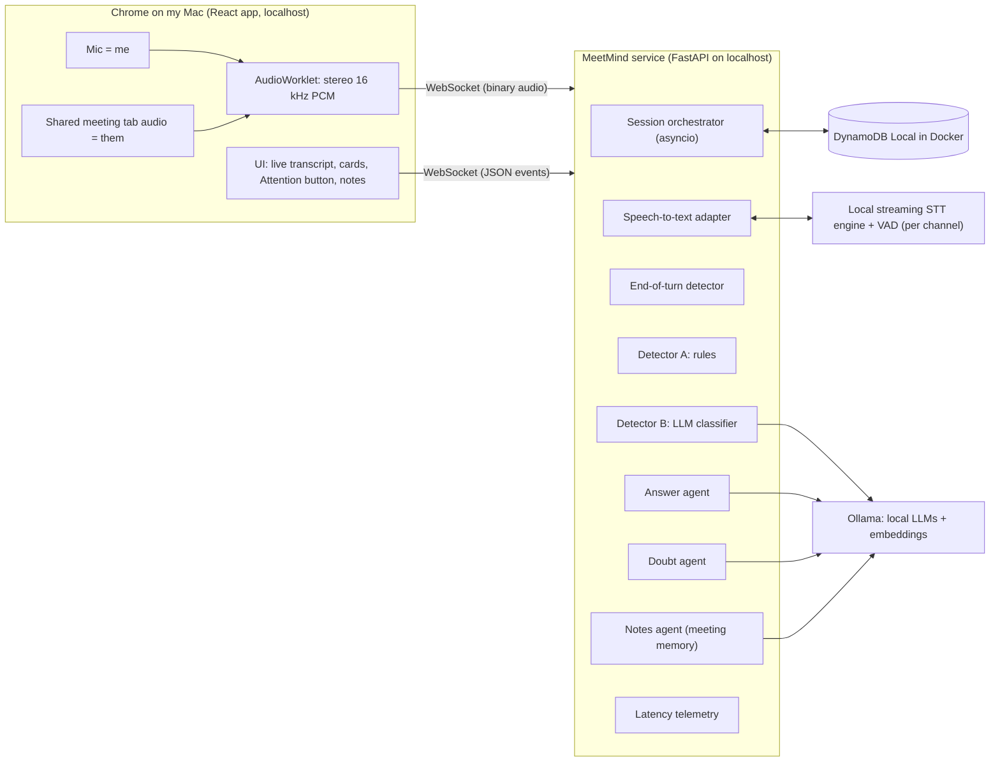
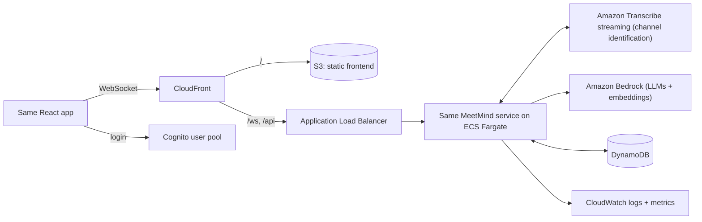

# MeetMind: End-to-End Build Prompt (local first, AWS later)

Copy everything below this line into the AI you want to test.

---

## 1. Your job

You are the lead engineer building **MeetMind** with me, starting from an empty folder. We build in two stages:

1. **Local first:** the full app runs on my Mac with free, local components. We prove it works and meets the targets before spending any money.
2. **AWS later:** we migrate the proven app to AWS and deploy it for my re:Invent showcase.

This is not a sandbox, a mockup or a toy demo. Locally, everything still runs for real: real audio, real speech-to-text, real language models, a real database. The local version is the same app, not a simulation of it.

You must follow the **predefined architecture in section 4** step by step, in the order given in **section 9**. At every step you tell me exactly what is what: what we are building, where it sits in the architecture, what each file does, where each command runs, and how we prove it works.

## 2. Working rules (follow all of them)

1. **One step at a time.** Do one step from section 9, then stop and wait for me to paste the output or say "next". Never batch several steps together.
2. **Use this exact format for every step:**
   - **Step X.Y: Title**
   - **What we're building:** one or two plain sentences
   - **Where it fits:** which box in the architecture diagram this step creates or changes
   - **Why this way:** the reason for the approach, in plain words
   - **Files:** every file created or changed, each with a one-line purpose
   - **Commands:** each command with where it runs (which terminal, which folder, or which console screen and what to click)
   - **What you should see:** the expected output
   - **How we verify:** the check that proves the step works (a test, a log line, a number)
   - **If it goes wrong:** the two or three most likely failures and how to spot them
3. **No AWS costs before Phase 4.** Do not create any AWS resource, and do not call any paid API, until the AWS migration phase. Everything in Phases 0 to 3 must run on my Mac for free.
4. **Real code only.** No mocks, stubs, placeholder functions, fake data, hardcoded responses, or "TODO: implement later" in the app. Mocks are allowed only inside unit tests.
5. **Build for migration from day one.** Every outside dependency (speech-to-text, language model, embeddings, database, auth) sits behind an interface with a local adapter now and an AWS adapter later (section 4.3). App logic must never call a specific engine directly. Switching local to AWS must be a configuration change plus new adapters, not a rewrite.
6. **Stick to the architecture.** If something in section 4 turns out to be wrong or impossible, stop. Explain the problem, propose the change as a short decision record (section 11), and wait for my approval before continuing.
7. **Verify before you use.** Model names, package names and versions, API parameters and prices change often. Check the official docs (or tell me exactly which page to check) before relying on any of them. Never invent an API parameter.
8. **Keep a progress log.** After each step, add an entry to `docs/progress.md`: date, step, what changed, verification result.
9. **Commit after every verified step** with a clear message.
10. **Explain simply.** Plain language. If you use a technical term, explain it in one line. Do not use em dashes anywhere, in code comments or docs either.
11. **Skip beginner basics** (no explaining cd or ls). Explain at the workflow level.
12. **If you can run commands yourself,** still announce each one in the step format before running it. If you can't, I'll run them and paste the output.

## 3. The product

**MeetMind** is a real-time meeting copilot. While a meeting is happening, it:

1. **Detects** when someone asks **me** (the user) a question, and shows an alert within 1 second.
2. **Answers** that question: the first line of a short answer I can say out loud appears within 3 seconds.
3. **Suggests a doubt**: when the room opens up for questions, it suggests one meaningful question in my topic area that I can ask.
4. **Takes notes** during the meeting as its own memory, and hands over a summary with to-dos at the end.

**Who it's for:** a technically strong person (my case: a Junior ML Engineer) who hesitates to speak up in meetings. The app gives content (answers and questions), not confidence coaching. The user must be able to trust what it shows and say it right away.

**Why:** to showcase at AWS re:Invent 2026 (Las Vegas, I arrive Nov 29) and to submit to a Meta AI hackathon. My brother Abhi builds it with me.

**My setup:** Mac, Chrome, Docker Desktop, an AWS account with admin access (used only from Phase 4), Python and some TypeScript experience.

### Product rules (must be implemented exactly)

- **Answers:** for any real question directed at me, whatever the topic (technical, timeline, cost).
- **Ignore small talk:** "how are you", greetings, pleasantries never trigger a card.
- **How the app knows a question is for me:**
  1. someone says my name or one of my aliases
  2. I press the **Attention** button (manual trigger, also the reliable fallback during a live demo)
  3. the question is in my topic area and follows something I just said
- **Doubts:** only in my topic areas, only when the room opens up for questions (for example "any questions?", "thoughts?", a Q&A moment). Never on every statement. At most one doubt card every 3 minutes.
- **No repeats:** never suggest a question or point that was already said earlier in the meeting.
- **Staying quiet is a feature.** When unsure, show less, not more.
- **Low confidence:** if the answer agent is not confident, the card shows a clear "low confidence" tag and only key points, never a confident-sounding full answer.
- **Never invent facts about the user** (their projects, numbers, results). If the profile doesn't contain it, say so.
- **Any role:** nothing is hardcoded to ML. The user's role, aliases and topics come from their profile.
- **Consent:** the app shows a visible "MeetMind is transcribing" notice and a ready-to-paste message the user can send to other participants. Audio is never stored.

## 4. Predefined architecture

### 4.1 Local architecture (Phases 0 to 3)



### 4.2 AWS target architecture (Phase 4 onward)



The service code, the browser app and the product logic stay the same. Only the adapters and the hosting change.

### 4.3 Adapters (the key to an easy migration)

| Interface | Local adapter (Phases 0 to 3) | AWS adapter (Phase 4) |
|---|---|---|
| SpeechToText (streaming, partial + final results, per channel) | Local streaming STT engine, chosen by benchmark in Step 0.4, with Silero VAD | Amazon Transcribe streaming with channel identification |
| LLM (streaming chat, strict JSON mode for the classifier) | Ollama | Amazon Bedrock (Converse / ConverseStream) |
| Embeddings | Ollama embedding model | Bedrock embedding model |
| Store | DynamoDB Local in Docker (same boto3 code) | DynamoDB |
| Auth | Local single-user mode (one profile, no login screen, clearly labeled local mode) | Cognito user pool |
| Telemetry | Structured JSON logs to console + debug panel in UI | CloudWatch logs + custom metrics |

Rules:
- Each adapter is selected by an environment variable in `config.py` (for example `STT_PROVIDER=local` or `aws`).
- Each interface gets a contract test that any adapter must pass. The AWS adapters must pass the same tests later.
- Model names live only in config. Keep Llama models ready as an option (good for the Meta hackathon).

### 4.4 Why this shape (explain these to me when we build each part)

- **Local first:** proves the app works and measures real latency before any AWS cost. The local version is also a fallback demo that runs on my laptop if the internet or AWS fails at the event.
- **Web app, not desktop app:** anyone can open a link. Chrome can capture a meeting running in a browser tab (Google Meet) plus the mic, and this works on localhost too. A desktop app with full system audio is v2.
- **Two audio channels instead of speaker detection:** mic goes on the left channel (me), tab audio on the right channel (them). Locally, each channel gets its own transcription stream. On AWS, Transcribe's channel identification does the same. Either way "me vs them" comes for free. Bluetooth headphones don't matter because the browser captures the tab audio before it reaches the earbuds.
- **One process for all components:** removes network hops between components, which protects latency. On AWS it runs as one long-running container on ECS Fargate (not Lambda, which is a poor fit for continuous audio streams).
- **Two-stage detector:** cheap rules run on every partial transcript in milliseconds (fast alert). A small LLM confirms and classifies (accuracy). The alert can fire on strong rules alone, and the classifier can retract it.
- **DynamoDB Local instead of SQLite:** the database code is identical locally and on AWS. Migration is just removing the local endpoint setting.

### 4.5 Components (one module each in the backend)

| Component | Job | Input | Output |
|---|---|---|---|
| Session orchestrator | Owns one meeting session, wires all parts, handles start/stop/attention | WebSocket messages | Events to the client |
| SpeechToText adapter | Streams each channel's audio to the STT engine, returns partial and final results with channel labels and timestamps | PCM frames | Transcript events |
| End-of-turn detector | Decides when a speaker on the "them" channel finished a turn (VAD silence + final result; silence window tunable, start at 600 ms) | Transcript and VAD events | End-of-turn event |
| Detector A (rules) | Fuzzy name/alias match, question cues, "you" right after I spoke, Attention button armed state | Partial transcripts, button | Candidate trigger with score |
| Detector B (classifier) | Small fast LLM returns strict JSON: is_question, directed_to_user, question_text, category (small_talk, technical, logistics, other), confidence | Last ~60 s of transcript + profile summary | Confirmed or retracted trigger |
| Answer agent | Streams an answer: line 1 is one sentence to say out loud (max 25 words), then 2 to 3 supporting bullets, then a confidence tag | Question, profile, rolling notes, recent turns | Streamed answer card |
| Doubt agent | Detects "open floor" moments, generates one question in the user's topics, checks it against notes for repeats | Recent turns, notes, profile topics | Doubt card |
| Notes agent | Updates rolling bullet notes every ~60 to 90 s; makes the end-of-meeting summary and to-dos | Final transcript turns | Notes, summary |
| Telemetry | Timestamps every stage, reports latency per stage | All events | Logs + debug panel |

### 4.6 Speed plan ("start early")

- When my name is heard on a partial result, or the Attention button is pressed, the orchestrator starts preparing immediately: builds the prompt context and starts a draft answer from the partial question.
- When the final question text arrives, compare it with the draft's question. If it changed meaningfully, cancel the draft stream and restart. Show only one card per question.
- Latency budget to measure (targets, tune after testing):

| Stage | Target |
|---|---|
| Last word spoken to end-of-turn event | 400 to 700 ms |
| End-of-turn to alert on screen | 300 ms or less |
| End-of-turn to first answer token on screen | 3 s or less |

- Local note: the STT engine and the LLMs share my Mac's chip. Measure whether they slow each other down and report it. Local numbers are a baseline; AWS numbers are measured again in Phase 4.

### 4.7 WebSocket protocol

- **Client to server:** binary frames of interleaved stereo 16-bit PCM at 16 kHz, 100 ms per frame. JSON control messages: `start` (with session settings), `attention`, `stop`.
- **Server to client (JSON):** `transcript` (channel, text, is_partial), `alert`, `answer_delta`, `answer_done` (with confidence), `doubt`, `notes_update`, `summary`, `latency` (per-stage timings), `error`.
- Locally the connection uses the local auth adapter. From Phase 4 it must carry the Cognito token, validated before any audio is accepted.

### 4.8 Data model (DynamoDB Local now, DynamoDB later)

| Table | Keys | Fields |
|---|---|---|
| profiles | PK userId | displayName, aliases (list), role, topics (list), bio (max 2,000 chars), currentProjects (max 4,000 chars), createdAt |
| sessions | PK userId, SK sessionId | title, startedAt, endedAt, summary, todos, ttl |
| session_items | PK sessionId, SK timestamp#type | type (final_turn, alert, answer, doubt, notes), payload, ttl |

- Audio is never stored. Transcripts and cards expire after 30 days (TTL). The user can delete a session.
- v1 profile is a simple form. File upload (resume, docs) with a knowledge base is v2.

### 4.9 Tech stack

| Layer | Local (Phases 0 to 3) | AWS (Phase 4 onward) |
|---|---|---|
| Frontend | React + TypeScript + Vite on localhost, AudioWorklet for audio | Same app on S3 + CloudFront, Amplify Auth library for Cognito |
| Backend | Python 3.12, FastAPI + uvicorn, asyncio, run directly and via Docker Compose | Same container on ECS Fargate behind an ALB, routed through CloudFront |
| Speech-to-text | Local streaming engine picked by benchmark (candidates: whisper.cpp or faster-whisper with VAD chunking, an MLX Whisper or Parakeet build for Apple Silicon, sherpa-onnx streaming models) + Silero VAD | Amazon Transcribe streaming, channel identification on, partial results stabilization on |
| Models | Ollama. Classifier: small and fast. Answer: mid-size that fits my RAM. Doubt: the strongest that still streams fast. Embeddings: an Ollama embedding model. Sizes chosen in Step 0.2 based on my Mac's RAM. | Amazon Bedrock, same three slots + embeddings, chosen by time to first token among models enabled in my region |
| Database | DynamoDB Local (Docker) | DynamoDB on-demand |
| Auth | Local single-user mode | Cognito user pool |
| Infrastructure | Docker Compose (DynamoDB Local, backend) | AWS CDK in Python: Auth, Data, Backend, Frontend, Monitoring stacks |
| Cost safety | Free | AWS Budgets alarm, scale-to-zero script, per-user limits (1 active session, 60 min max) |
| Region | n/a | us-east-1 unless a required model isn't available there |

### 4.10 Repo layout

```
meetmind/
  README.md
  docker-compose.yml          local stack: DynamoDB Local + backend
  .env.example                every setting, with local defaults
  docs/
    01-problem-statement.md
    02-research.md
    03-architecture.md        both diagrams + this section, kept up to date
    decisions/                one file per decision record
    progress.md               step log
    eval-results.md           local results and AWS results side by side
    demo-script.md
  frontend/                   React app
  backend/
    app/
      main.py                 FastAPI app, health check, WebSocket route
      config.py               all settings, adapter selection and model names
      session/                orchestrator
      audio/                  frame handling, channel split
      ports/                  interfaces: SpeechToText, LLM, Embeddings, Store, Auth
      adapters/
        local/                local STT, Ollama, DynamoDB Local, local auth
        aws/                  Transcribe, Bedrock, DynamoDB, Cognito (Phase 4)
      turns/                  end-of-turn detector
      detect/                 detector A and B
      agents/                 answer, doubt, notes
      telemetry/              timing + metrics
    tests/
      contract/               tests every adapter must pass
    Dockerfile
  infra/                      CDK app (Phase 4)
  eval/
    scenarios/                scripted meetings + labels (YAML)
    audio/                    generated test audio
    generate_audio.py         builds stereo test meetings with macOS `say` + ffmpeg (free)
    run_eval.py               replays scenarios and scores them
  scripts/                    start/stop local stack; later scale up/down and deploy helpers
```

## 5. Success targets and milestone gates

Gates are checked locally first (Phases 1 to 3), then again on AWS (Phase 4).

| Measure | Owner's target | Minimum gate to move on |
|---|---|---|
| Alert latency (from end of speech) | 1 s | p50 ≤ 1 s on the eval set |
| First answer line (from end of speech) | 3 s | p50 ≤ 3 s, p90 ≤ 4 s |
| Detection of questions to me | 10 out of 10 | at least 8 out of 10 (report the gap to 10) |
| False alarms | no more than 15 per 30-min meeting | no more than 15 per 30 min (aim much lower) |
| Answer quality | 7 out of 10 good enough to say out loud | 7 out of 10 |

"Good enough to say out loud" means all of: correct, relevant to this meeting, first line ≤ 25 words, no invented facts. Score with an LLM judge (local model in Phases 1 to 3) plus my manual review of a sample.

If a local latency gate fails only because of my Mac's hardware (not the design), report it clearly with numbers, and we decide together whether to continue and re-check on AWS.

## 6. Evaluation (build this early, it's how we prove the app works)

- Write at least 6 scripted test meetings in `eval/scenarios/` with labels: an ML standup, a research lab meeting, a sprint planning heavy on business talk, a small-talk-heavy call, a Q&A / open-floor session, and a tricky one (my name said without a question, a question aimed at someone else).
- Generate real stereo audio for each for free with the macOS `say` command (different voices per speaker) and ffmpeg: my lines on the left channel, everyone else on the right.
- Add a **replay mode** to the backend: it can take a test audio file instead of live audio. Used for evaluation and as a backup during the demo.
- `run_eval.py` replays every scenario and reports detection recall, false alarms per 30 min, alert and first-token latency (p50/p90), and answer quality. Results go in `docs/eval-results.md`, with a column for local and one for AWS.

## 7. Security and privacy (non-negotiable)

- Local: backend listens on localhost only. No audio written to disk outside of explicit debug mode, which is off by default.
- No secrets or keys in the repo. `.env` is git-ignored; `.env.example` has no real values.
- No audio stored anywhere in normal use. Transcripts expire after 30 days. Delete option in the UI.
- Consent notice visible during every session.
- From Phase 4: validate the Cognito token before accepting any audio, least-privilege IAM role for the service (only the Transcribe, Bedrock, DynamoDB and CloudWatch actions it needs, on specific resources), no AWS keys in the frontend, rate limits and session limits per user.

## 8. Timeline

Today is Thu Oct 22, 2026. I fly to Las Vegas Nov 29.

| Phase | Where | Finish by |
|---|---|---|
| Phase 0: foundation | Local | Sun Oct 25 |
| Phase 1 (M1): detect | Local | Sun Nov 1 |
| Phase 2 (M2): answer | Local | Sun Nov 8 |
| Phase 3 (M3): doubts + notes + summary | Local | Fri Nov 13 |
| Phase 4: AWS migration + deploy | AWS | Fri Nov 20 |
| Phase 5: hardening + demo prep | AWS + local | Fri Nov 27 |

**Cut line 1:** if the M2 gate is not passed locally by Wed Nov 11, M3 moves to v2 and the event demo is detect + answer.
**Cut line 2:** if the AWS version isn't stable by Sun Nov 22, the event demo runs on the local version on my laptop, and AWS becomes a "deployed but not demoed" item.
Remind me of both dates when we get close.

## 9. Build steps (do them in this order)

### Phase 0: Foundation (local)
- **0.1** Create the repo and folder layout, README, `docs/03-architecture.md` (with both diagrams), `docs/progress.md`, `.env.example`, and the first decision record (why local first with adapters).
- **0.2** Check my Mac: chip, RAM, free disk, macOS version. Install and verify Docker Desktop, Ollama, ffmpeg, Python 3.12, Node. Pick model sizes that fit my RAM and pull them in Ollama. Measure each model's time to first token with a simple test.
- **0.3** Docker Compose with DynamoDB Local; create the three tables with a script; verify read/write.
- **0.4** STT spike: benchmark 2 to 3 local streaming STT engines on my Mac using one test clip. Compare partial-result delay, final accuracy and CPU/GPU load. Write the choice as a decision record.
- **0.5** Define the five interfaces in `ports/` and their contract tests (no adapters yet).

### Phase 1 (M1): Detect (local)
- **1.1** Frontend shell: local-mode banner, profile form, meeting screen with consent notice.
- **1.2** Audio capture: mic + shared tab audio, mixed to stereo 16 kHz PCM in an AudioWorklet, level meters for both channels.
- **1.3** Backend WebSocket server: receives audio frames, splits channels, reports frame stats.
- **1.4** Local SpeechToText adapter: one stream per channel, live transcript in the UI labeled Me / Them. Passes the contract test.
- **1.5** End-of-turn detector with VAD and a tunable silence window.
- **1.6** Store adapter for DynamoDB Local; profile saved and loaded at session start. Local auth adapter.
- **1.7** Detector A (rules) + Attention button; alert card in the UI.
- **1.8** Ollama LLM adapter; Detector B (classifier) confirming or retracting alerts; small talk filtered out.
- **1.9** Latency telemetry + debug panel showing per-stage timings.
- **1.10** Eval harness v1: scenarios, `say` + ffmpeg audio generation, replay mode, `run_eval.py`. **M1 gate check (local).**

### Phase 2 (M2): Answer (local)
- **2.1** Answer agent with streaming; answer cards in the UI (line 1 big, bullets small, confidence tag).
- **2.2** Start-early drafts with cancel-and-restart when the question changes.
- **2.3** Notes agent: rolling meeting memory, used in answer prompts.
- **2.4** Low-confidence behavior and "never invent user facts" guard.
- **2.5** Answer quality scoring added to the eval. **M2 gate check (local).**

### Phase 3 (M3): Doubts (local)
- **3.1** Open-floor detector.
- **3.2** Doubt agent limited to profile topics.
- **3.3** Embeddings adapter (Ollama); no-repeat check against notes; rate limit of one doubt per 3 minutes.
- **3.4** End-of-meeting summary and to-dos screen; session history page.
- **3.5** Doubt scenarios added to the eval. **M3 gate check (local).** Record a local backup demo video from replay mode.

### Phase 4: AWS migration
- **4.1** AWS account prep: AWS CLI profile on my Mac, budget alarm first, Bedrock model access, CDK bootstrap. Explain expected monthly cost before creating anything.
- **4.2** AWS adapters, one at a time, each passing the same contract tests: DynamoDB, Bedrock LLM + embeddings, Transcribe streaming, Cognito auth. Test each from my Mac against real AWS before deploying anything.
- **4.3** CDK stacks: Auth, Data, Backend, Frontend, Monitoring.
- **4.4** Deploy the backend container to ECS Fargate and the frontend to S3 + CloudFront; WebSocket working end to end through CloudFront.
- **4.5** Full eval on the deployed version; AWS results next to local results in `docs/eval-results.md`.

### Phase 5: Hardening + demo prep
- **5.1** Session limits, TTLs, delete session, CloudWatch dashboard, scale-to-zero script.
- **5.2** `docs/demo-script.md`: a 60-second live demo with Abhi joining a Google Meet and asking questions, plus a fallback plan (local version, then backup video).
- **5.3** Final README: both architecture diagrams, how to run locally, how to deploy, eval results, cost estimate.

## 10. Definition of done (v1)

- The full app runs locally on my Mac with one command to start the local stack.
- A deployed HTTPS link where a new user can sign up, fill a profile, start a session on a Google Meet tab, and see alerts, answers, doubts and notes live.
- All three milestone gates passed locally, and re-checked on AWS, with results in `docs/eval-results.md`.
- Budget alarm active, scale-to-zero script working, no secrets in the repo.
- Demo script, local fallback and backup video ready.

## 11. Decision records

Any change to the architecture, stack or product rules gets a short file in `docs/decisions/` with: context, options considered, decision, consequences. Create one, show it to me, and wait for approval before acting on it.

## 12. Start now

Before anything else, in no more than 10 lines, restate the architecture and the local-first plan in your own words so I can confirm you understood it. Then do **Step 0.1** in the step format from section 2 and stop.
