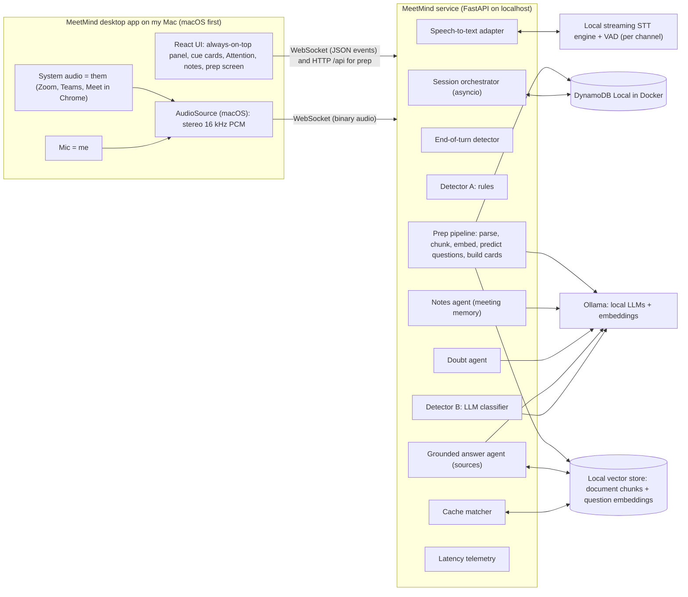
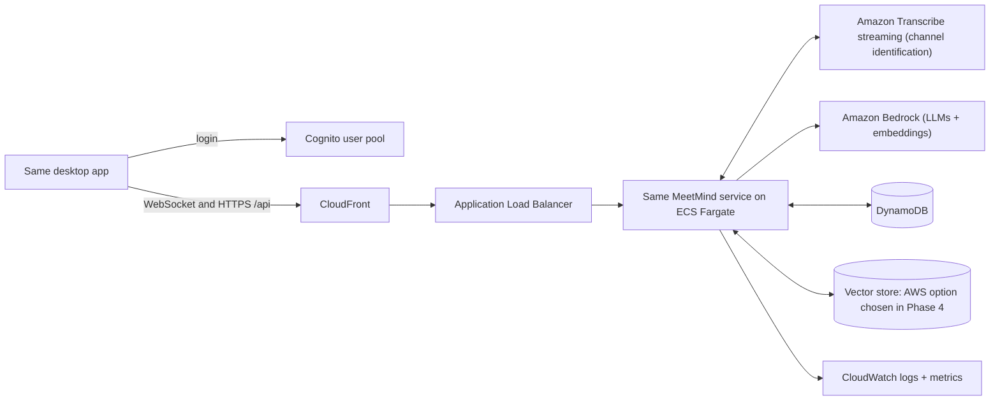

# Architecture

This document is the single source of truth for how MeetMind is built. It is kept up to date as steps land. Spec changes are recorded in `docs/decisions/`.

## 1. Shape in one paragraph

A desktop app on the user's machine captures two audio sources: the microphone (me) on the left channel and the system audio (them) on the right channel. It streams stereo 16 kHz PCM over one WebSocket to a single Python service. That service transcribes each channel, detects when a question is aimed at the user, matches it against cue cards prepared before the meeting, and otherwise generates a grounded answer live from the user's documents. Every outside dependency sits behind an interface with a local adapter now and an AWS adapter later.

## 2. Local architecture (Phases 0 to 3)



## 3. AWS target architecture (Phase 4 onward)



The service code, the desktop app and the product logic stay the same. Only the adapters and the hosting change. The desktop app connects to a different address.

Since the UI now ships inside the desktop app, the S3 static frontend from the original plan is no longer needed to serve the UI. Whether to keep an S3 + CloudFront page for downloading the Mac build is an open decision for the owner (see section 12).

## 4. Adapters

| Interface | Local adapter (Phases 0 to 3) | AWS adapter (Phase 4) |
|---|---|---|
| SpeechToText (streaming, partial + final results, per channel) | mlx-whisper (whisper-small on the Apple GPU), segments cut by Silero VAD, partials refreshed once a second. Chosen in Step 0.4, decision 0004 | Amazon Transcribe streaming with channel identification |
| LLM (streaming chat, strict JSON mode for the classifier) | Ollama | Amazon Bedrock (Converse / ConverseStream) |
| Embeddings | Ollama embedding model | Bedrock embedding model |
| Store | DynamoDB Local in Docker (same boto3 code) | DynamoDB |
| Auth | Local single-user mode (one profile, no login screen, clearly labeled local mode) | Cognito user pool |
| DocumentParser (PDF, Markdown, text, DOCX if practical) | Local parsing library, best current option verified in Step 2.1 | Same code, runs in the service |
| VectorStore (chunks and question embeddings, similarity search) | Local embedded vector store, two options compared in Step 2.1 with a decision record | Chosen in Phase 4 after checking current AWS options (Bedrock Knowledge Bases, OpenSearch Serverless, S3 Vectors) |
| Telemetry | Structured JSON logs to console + debug panel in the UI | CloudWatch logs + custom metrics |

Rules:
- Each adapter is selected by an environment variable in `backend/app/config.py`, for example `STT_PROVIDER=local` or `aws`.
- Each interface has a contract test that every adapter must pass. The AWS adapters pass the same tests later.
- Model names live only in config. Llama models stay ready as an option for the Meta hackathon.
- App logic never calls an engine directly. It only talks to the interface.

Inside the desktop app, audio capture sits behind its own `AudioSource` interface with a macOS implementation now and a Windows one later. The macOS implementation is Chromium's built-in system audio loopback (Core Audio taps, macOS 14.2 and later) inside Electron, with no native helper. Decision 0005.

## 5. Why this shape

- **Local first:** proves the app works and measures real latency before any AWS cost. The local version is also the fallback demo if the internet or AWS fails at the event.
- **Desktop app, not web page:** a web page can only hear a browser tab. A desktop app can capture system audio, so it works with Zoom and Teams desktop as well as Meet in Chrome. It never joins the meeting. Bluetooth headphones do not matter because system audio is captured before it reaches the earbuds.
- **Two audio channels instead of speaker detection:** mic on the left (me), system audio on the right (them). Locally each channel gets its own transcription stream. On AWS, Transcribe's channel identification does the same. "Me vs them" comes for free.
- **One process for all components:** no network hops between parts, which protects latency. On AWS it runs as one long-running container on ECS Fargate, not Lambda, which is a poor fit for continuous audio.
- **Two-stage detector:** cheap rules run on every complete sentence in milliseconds (fast alert; decision 0007 dropped partials). A small LLM confirms and classifies (accuracy). The alert can fire on strong rules alone, and the classifier can retract it.
- **Prepare before the meeting:** most questions can be predicted from the agenda and documents. Preparing cards ahead of time makes the common case instant and lets the user review and edit answers before anyone asks.
- **Grounded answers with sources:** personal facts come only from the profile or documents, so the user can trust the card and say it right away.
- **DynamoDB Local instead of SQLite:** identical database code locally and on AWS. Migration is removing the local endpoint setting.

## 6. Components (one module each in the backend)

| Component | Job | Input | Output |
|---|---|---|---|
| Session orchestrator | Owns one meeting session, wires all parts, handles start, stop and Attention | WebSocket messages | Events to the client |
| SpeechToText adapter | Streams each channel's audio to the STT engine, returns partial and final results with channel labels and timestamps | PCM frames | Transcript events |
| End-of-turn detector | Decides when a speaker on the "them" channel finished a turn (VAD silence + final result; silence window tunable, start at 600 ms) | Transcript and VAD events | End-of-turn event |
| Detector A (rules) | Fuzzy name or alias match, question cues, "you" right after I spoke, Attention button armed state. A handoff ("Surya, do you want to take that one?") is answered as the question somebody asked just before it | Partial transcripts, button | Candidate trigger with score |
| Detector B (classifier) | Small fast LLM returns strict JSON: is_question, directed_to_user, question_text, category (small_talk, technical, logistics, other), confidence | The sentence that raised the alert, last ~60 s of transcript, profile summary | Confirmed or retracted trigger |
| Cache matcher | Embeds the detected question, searches this session's prepared cards. Hit above a tunable threshold shows the prepared card at once. Miss hands over to the answer agent. Logs every decision with its score | Question text | Prepared card or miss |
| Grounded answer agent | Retrieves the top relevant document chunks plus meeting notes, streams a cue card with sources. Personal facts only from profile or documents, otherwise "Not in your docs". Follow-ups build on the previous card. With See my screen on, a question that points at the screen ("this chart") is written with a picture of the screen (decision 0009) | Question, profile, chunks, notes, recent turns, previous card, screen picture | Streamed cue card |
| Claim checker | "You're just doing X, right?": reads the user's documents whole (up to CLAIM_CONTEXT_CHARS, in a fixed order so the model's prompt cache keeps them) and returns supports, contradicts or not found with a quote. A verdict counts only when the quote is in a document; then the card shows the correction or confirmation and the quote (decision 0009) | Claim, all document pieces | Verdict, line, quote, source |
| Doubt agent | Rules spot an open floor in what others say ("any questions?", "thoughts?"); the agent writes one question in the user's topics from the last three minutes, the notes and the nearest document pieces, which may state the user's own practice and cite it. Quiet when others have said under 40 words or the user did most of the talking. A suggestion within 0.72 of a question already asked or suggested is dropped. At most one on its own every 3 minutes; the Suggest a question button asks at any time (decision 0009) | Recent turns, notes, profile topics, chunks | Doubt card |
| Notes agent | Updates rolling bullet notes every ~60 to 90 s; makes the end-of-meeting summary and to-dos | Final transcript turns | Notes, summary |
| Prep pipeline | Before the meeting: parses and chunks documents, embeds them, predicts 20 to 40 questions likely to be asked to this user with phrasing variants, builds a grounded cue card per question, stores cards and question embeddings. Runs as a background job with progress | Agenda, participants, documents, profile | Document chunks, prep cards |
| Telemetry | Timestamps every stage, reports latency per stage | All events | Logs + debug panel |

## 7. The two flows

### Before the meeting (prep)

1. The user adds documents (PDF, Markdown, text, DOCX) on the Documents tab, and on the Prepare tab saves the meeting: title, the agenda pasted as it is, who attends. The prepared meeting is a session record with `startedAt` 0 until it is held.
2. DocumentParser turns each file into chunks that remember their document name and section or page. Embeddings go into the VectorStore. Metadata goes into the `documents` table.
3. The question predictor reads the agenda, who attends, the profile and, for every agenda line, the three document pieces that match it best (within 6,000 characters), and predicts 20 to 30 questions most likely to be asked to this user, each with 2 or 3 phrasings, as strict JSON.
4. The cache builder writes a card for each predicted question with the same answer agent as a live card, stores it in `prep_cards`, and puts the question and its phrasings in the VectorStore under the meeting's own collection (`prep:<sessionId>`). It runs in the background; the Prepare tab shows its progress. Preparing again keeps the cards the user edited.
5. The review screen lets the user read, edit, delete or add cards. Edited cards count as user-approved and rank higher in matching.
   Rehearse reads each predicted question out loud; the user answers into the microphone; the answer is transcribed through the SpeechToText port in memory, checked by the claim checker and offered as the card in the user's own words (decision 0009).
6. Target: finishes within a few minutes for a normal agenda plus about 10 documents. Measured: 27 cards in about 3 to 5 minutes on the owner's Mac (docs/progress.md, steps P.3 and P.5).

### During the meeting (live)

1. Audio arrives as stereo frames. Each channel goes to its own STT stream.
2. Detector A runs on every complete sentence from the others (a final transcript, after the speaker pauses). A strong rule hit, or the Attention button, fires the alert and starts the card. Nothing is written on a partial (decision 0007).
3. Detector B confirms or retracts. Small talk is dropped.
4. The cache matcher embeds the question and searches this session's cards. Hit: the prepared card is shown, labeled Prepared. Miss: the grounded answer agent streams a live card, labeled Live.
5. Cards are pinned. A shown card never changes or disappears. New cards queue below with a counter. The user moves on with a shortcut or a click.
6. The notes agent keeps rolling notes. The doubt agent watches for open-floor moments. At stop, the summary and to-dos are produced.

## 8. Cue card format

- **Line 1:** the cue, one short sentence to say naturally, max 20 words.
- **Then:** 2 to 4 short cue points (key facts, numbers, names), not a paragraph.
- **Footer:** source chips (document name and section or page), a Prepared or Live label, and confidence.
- **Low confidence:** only cue points with a clear "low confidence" tag, never a confident-sounding full answer.
- One card per question. If the question changes while a live card is generating, cancel and restart before showing. Never swap a card that is already shown.

## 9. Speed plan ("start early")

- When a complete sentence fires the rules, or Attention is pressed, the orchestrator starts at once: it builds the prompt context, runs the cache matcher on the question, and starts the live answer. Show only one card per question. Drafts on partial text were tried in Step 2.4 and removed after the first real meeting (decision 0007).

| Stage | Target |
|---|---|
| Last word spoken to end-of-turn event | 400 to 700 ms |
| End-of-turn to alert on screen | 300 ms or less |
| End-of-turn to prepared card on screen (cache hit) | 1 s or less |
| End-of-turn to first cue line on screen (cache miss) | 3 s or less |

Local note: the STT engine and the LLMs share the Mac's chip. We measure whether they slow each other down and report it. Local numbers are a baseline. AWS numbers are measured again in Phase 4.

## 10. WebSocket protocol

- **Client to server:** binary frames of interleaved stereo 16-bit PCM at 16 kHz, 100 ms per frame (6,400 bytes). JSON control messages: `start` (the service loads the saved profile itself; with `replay_file` the service plays that test meeting from `REPLAY_DIR` at real-time pace instead of taking live audio, and stops at its end; with `prep_session_id` the session is that prepared meeting and its cards are matched; `one_on_one`, `use_documents` and `see_screen` may ride along), `attention`, `doubt` (the user asks for a question to ask), `one_on_one`, `use_documents`, `see_screen`, `screen` (the picture of the screen a `screen_request` asked for, base64 JPEG, or null), `stop`.
- **Server to client (JSON):** `started` (with the session id), `stats` (once per second of audio: frames, audio seconds, me and them level in dB), `transcript` (channel, text, is_partial, start_s, end_s), `turn` (a speaker finished, with the detection delay), `alert` (Detector A fired: question, score, reasons, then status confirmed or retracted with category and confidence once Detector B has read the final text), `latency` (per question: alert, turn known and classified relative to the last word, classifier ms), `answer_delta`, `cache_match` (in a prepared meeting, before the card: the best prepared question, its score, hit or miss), `screen_request` (a question points at the screen and See my screen is on: the app sends one picture, the card waits up to 1.5 s for it), `answer_done` (with label prepared or live, sources, confidence; a cache hit sends the whole card at once; tags say whether a claim was settled from the documents and whether the screen was read), `doubt` (id, question or null, why, sources, reason open floor or asked), `notes_update`, `summary`, `stopped`, `error`.
- **HTTP side:** `GET /api/health` (status and auth mode), `GET` and `PUT /api/profile`, `GET /api/replays` (test meetings replay mode can play). Documents: `GET`, `POST /api/documents`, `DELETE /api/documents/{docId}`. Prepared meetings (Phase 2P): `GET`, `POST /api/prep`, `PUT` and `DELETE /api/prep/{sessionId}`; `POST /api/prep/{sessionId}/build` starts building the cards, `GET .../status` reads its progress, `GET` and `POST .../cards` list cards and add one for a question, `PUT` and `DELETE .../cards/{cardId}` edit and remove; `POST .../cards/{cardId}/rehearse` takes the user's spoken answer as raw frames and returns what was heard, the answer as a card in their own words and what the documents say about it, saving nothing (decision 0009). Local mode sends no token; from Phase 4 every HTTP call carries the Cognito token as a bearer header and the WebSocket carries it as a query parameter, both checked through the Auth port.
- Locally the connection uses the local auth adapter. From Phase 4 it carries the Cognito token, validated before any audio is accepted.

## 11. Data model (DynamoDB Local now, DynamoDB later)

| Table | Keys | Fields |
|---|---|---|
| profiles | PK userId | displayName, aliases (list), role, topics (list), bio (max 2,000 chars), currentProjects (max 4,000 chars), createdAt |
| sessions | PK userId, SK sessionId | title, startedAt, endedAt, summary, todos, ttl |
| session_items | PK sessionId, SK timestamp#type | type (final_turn, alert, answer, doubt, notes), payload, ttl |
| documents | PK userId, SK docId | name, type, addedAt, chunkCount, status |
| prep_cards | PK sessionId, SK cardId | predictedQuestion, variants, card, sources, userEdited, createdAt, ttl |

- Vectors live in the VectorStore, not in DynamoDB.
- Audio is never stored. Transcripts and cards expire after 30 days (TTL). The user can delete a session.
- v1 profile is a simple form.

## 12. Open decisions for the owner

- **Hiding the window from screen share.** Not built unless approved. v1 shows a normal visible window.
- **S3 + CloudFront page for the Mac build.** The UI no longer needs static hosting. Keep a download page or drop the Frontend stack.
- **Definition of done wording.** The original said "a deployed HTTPS link where a new user can sign up". With a desktop app this becomes "a Mac build that signs up against the deployed backend". Confirm.

## 13. Repo layout

```
meetmind/
  README.md
  docker-compose.yml          local stack: DynamoDB Local + backend (Step 0.3)
  .env.example                every setting, with local defaults
  docs/
    00-build-prompt.md        the original spec
    00-spec-update-1.md       spec update 1 (desktop app, prep + cache, cue cards)
    01-problem-statement.md
    02-research.md            (later)
    03-architecture.md        this file
    decisions/                one file per decision record
    progress.md               step log
    eval-results.md           local and AWS results side by side (Step 1.10)
    demo-script.md            (Phase 5)
  desktop/                    desktop app: shell, React UI, AudioSource. Inner layout fixed in Step 0.6
  backend/
    app/
      main.py                 FastAPI app, health check, WebSocket route, /api routes
      config.py               all settings, adapter selection and model names
      session/                orchestrator
      audio/                  frame handling, channel split
      ports/                  interfaces: SpeechToText, LLM, Embeddings, Store, Auth, DocumentParser, VectorStore
      adapters/
        local/                local STT, Ollama, DynamoDB Local, local auth, local parser, local vector store
        aws/                  Transcribe, Bedrock, DynamoDB, Cognito, AWS vector store (Phase 4)
      turns/                  end-of-turn detector
      detect/                 detector A and B
      agents/                 grounded answer, doubt, notes
      prep/                   chunking, question predictor, cache builder, cache matcher
      telemetry/              timing + metrics
    tests/
      contract/               tests every adapter must pass
    Dockerfile
  infra/                      CDK app (Phase 4)
  eval/
    scenarios/                scripted meetings + labels + prep packs (agenda and documents), YAML
    audio/                    generated test audio
    generate_audio.py         builds stereo test meetings with macOS say + ffmpeg (free)
    run_eval.py               replays scenarios and scores them
  scripts/                    start/stop local stack; later scale up/down and deploy helpers
```
